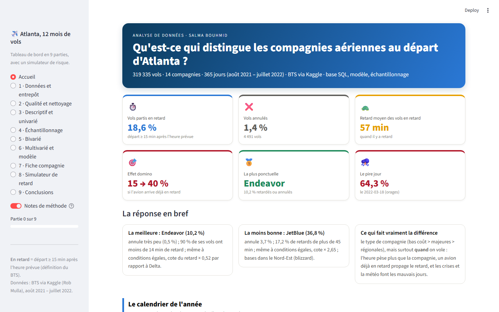
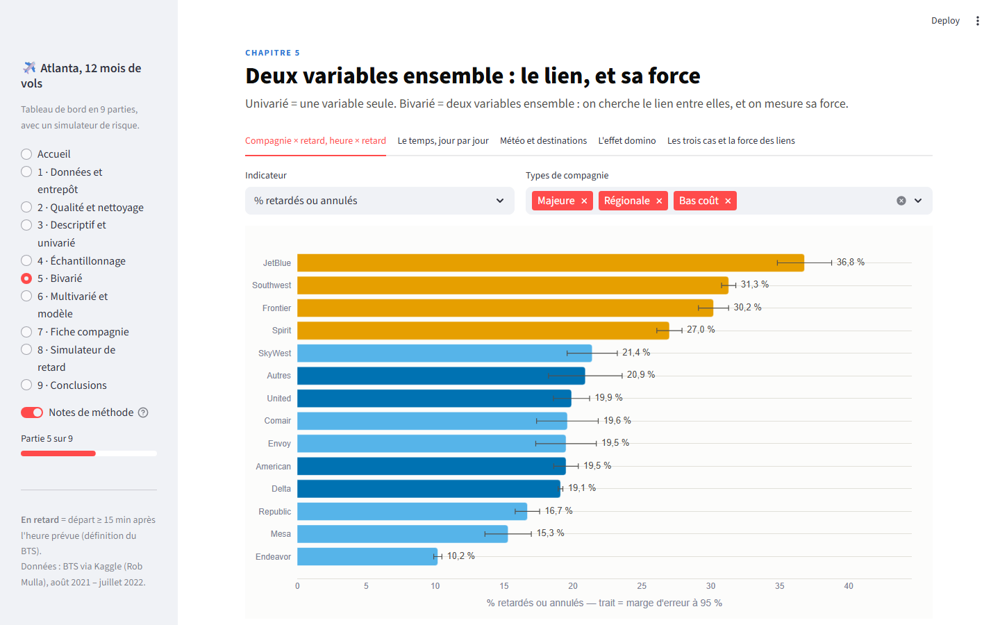
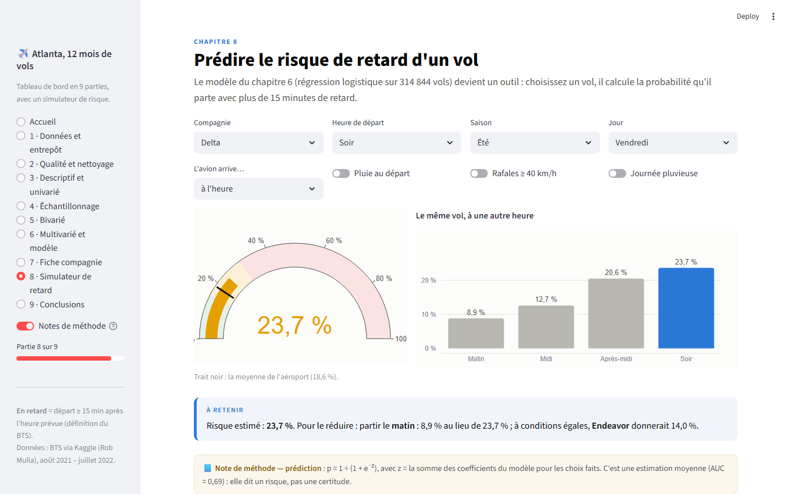
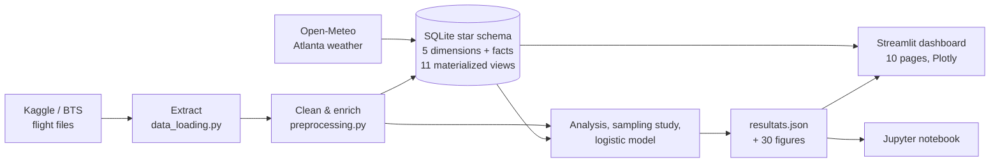

# ✈️ Atlanta Airline Performance

**Which airlines are the most reliable out of Atlanta (ATL), the busiest airport in the world, and why?**
An end-to-end data project on **319,335 flights** (Aug 2021 – Jul 2022, 14 airlines): data cleaning, a SQLite star
schema with 11 SQL views, statistical analysis, a sampling study, a logistic-regression model and an interactive
10-page Streamlit dashboard.

[](https://github.com/SalmaBouhmid/atlanta-airline-performance/actions/workflows/ci.yml)


**▶ Live dashboard: [atlanta-airline-performance.streamlit.app](https://atlanta-airline-performance.streamlit.app/)** · 🇫🇷 [Version française](README.fr.md)



| Bivariate analysis with 95% error bars | Delay-risk simulator (logistic model) |
|---|---|
|  |  |

> The dashboard is in French. The code, the data model and this README are documented so that they can be read without it.

---

## Key findings

| | Finding |
|---|---|
| **Best / worst** | Regional carriers are the most punctual (Endeavor: 10% of flights delayed or cancelled); low-cost carriers the least (JetBlue: 37%), with more severe delays. |
| **Composition effect** | Part of the gap comes from *when* airlines fly: at equal departure hour, American goes from 17.4% to 20.9% delayed; at equal month, SkyWest drops from 5th to 11th place. |
| **Delay propagation** | 40.5% of departures are late when the same aircraft's previous departure was late, vs 15.4% otherwise. |
| **Day by day** | Delays come in short crises (from 3% to 64% depending on the day). Ten real events (Spirit meltdown Aug 2021, Southwest Oct 2021, Omicron at Christmas, winter storm Izzy…) are visible in the data and documented with a source. |
| **Weather** (Open-Meteo join) | 14.1% delayed on a dry day vs 24.5% on a day of heavy rain. |
| **Model** (logistic regression) | All else equal, an evening departure multiplies the odds of delay by 3.2, an aircraft already late by 3.1, JetBlue by 2.7 (vs Delta): **time of day matters more than the airline**. Test AUC 0.69 (70/30 split): the model compares factors, it does not predict individual flights. |
| **Sampling study** | 6 sampling designs × 100 draws × sizes from 1,000 to 20,000 flights. The big conclusions survive every method; fine differences between close airlines do not. To compare airlines, stratify with equal allocation and re-weight for any global figure. |
| **Honesty checks** | The middle of the ranking cannot be separated (28 of 91 pairs, Bonferroni-corrected tests); the regional advantage is mostly Endeavor's. |

*Observed associations, not causal claims.* All figures come from [`reports/resultats.json`](reports/resultats.json), regenerated by the pipeline.

## Architecture



- **Bronze → silver → gold**: raw Kaggle files → cleaned parquet (`data/processed`) → SQLite warehouse and `resultats.json`.
- **Warehouse**: fact table `vols` joined to 5 tables (airlines, destinations, calendar, real-world events, hourly weather);
  11 SQL views, one per analytical question, materialized as `mv_*` tables and tested against the pandas results
  (`sql/01_tables.sql`, `sql/02_vues.sql`, `src/base_de_donnees.py`).
- **Quality**: missing-value pattern analysis, survivor-bias correction ("delayed **or** cancelled" indicator), IQR outlier rule.
- **Tests**: 91 automated tests (pytest) run on every push by GitHub Actions, plus `ruff` linting.
- **Cloud-ready**: the 163 MB SQLite file is not versioned; the dashboard rebuilds it from the parquet on first start (~30 s).

## Dashboard pages

Home · 1 Data & warehouse · 2 Quality & cleaning · 3 Descriptive & univariate · 4 Sampling · 5 Bivariate ·
6 Multivariate & model · 7 Airline profile · 8 Delay-risk simulator · 9 Conclusions.
A "Notes de méthode" toggle shows or hides the boxes explaining the statistical method behind each chart.

## Run it locally

```bash
git clone https://github.com/SalmaBouhmid/atlanta-airline-performance.git
cd atlanta-airline-performance
pip install -r requirements.txt
streamlit run dashboard/app.py      # the SQLite warehouse is built automatically on first start
```

Full pipeline:

```bash
python pipeline.py                  # cleaning + SQLite warehouse + resultats.json
python src/sampling_study.py        # sampling study (~15 min)
python src/figures.py               # all figures
python outils/construire_notebook.py  # rebuilds the notebook from the results
python -m pytest                    # 91 tests
```

To rebuild from the original Kaggle files, put `Combined_Flights_2021.csv.zip` and `Combined_Flights_2022.parquet`
from [Flight Status Prediction](https://www.kaggle.com/datasets/robikscube/flight-delay-dataset-20182022) in `data/raw/`
and run `python pipeline.py --extraire` (they are too large for GitHub).

## Project structure

```
atlanta-airline-performance/
├── pipeline.py               # extract → clean → warehouse → results, in one command
├── src/                      # loading, cleaning, analysis, sampling, SQL warehouse, model, figures
├── sql/                      # 01_tables.sql (star schema) and 02_vues.sql (11 views)
├── data/                     # processed parquet, Open-Meteo weather (raw Kaggle files not versioned)
├── dashboard/app.py          # Streamlit dashboard (10 pages)
├── notebooks/analysis.ipynb  # full analysis narrative
├── reports/                  # resultats.json, figures/, sampling results
├── tests/                    # 91 pytest tests
└── docs/DATASET.md           # data dictionary
```

## Tech stack

Python · pandas · NumPy · pyarrow · SQLite (views, window functions) · statsmodels · scikit-learn · SciPy ·
Plotly · Matplotlib · Streamlit · Jupyter · pytest · ruff · GitHub Actions

## Limitations

- Only departures from Atlanta are in the data: the "previous flight" of an aircraft is its previous ATL departure that day.
- The fact table also keeps a few descriptive columns to simplify the views; a strict star schema would keep only keys and measures.
- Destinations are mapped by US state (the file has no airport coordinates).
- Logistic regression without interactions: built to compare factors, not to predict each flight.

## Data & license

Data: [Flight Status Prediction](https://www.kaggle.com/datasets/robikscube/flight-delay-dataset-20182022) by Rob Mulla (CC0),
from the US Bureau of Transportation Statistics; weather from [Open-Meteo](https://open-meteo.com/).
Code under the [MIT license](LICENSE).

**Author:** Salma Bouhmid — data engineering
